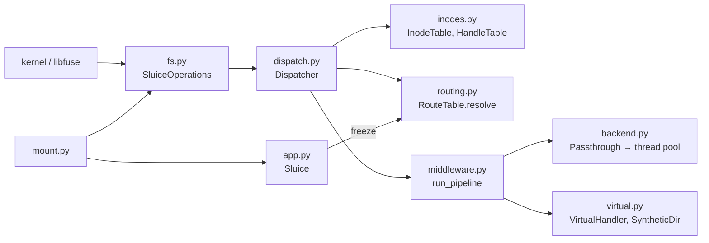

# Architecture Internals

How sluice works inside: for contributors, reviewers and AI assistants. User-facing behaviour belongs on the other pages.

## Overview

The kernel sends each filesystem call to `fs.py`, a thin pyfuse3 adapter. It converts the call and hands it to the `Dispatcher`, which does everything else without knowing about pyfuse3. The dispatcher turns the inode or handle into a virtual path (`InodeTable`), resolves it against the frozen `RouteTable`, builds a `Context`, and runs the middleware pipeline around one operation. The operation is a passthrough syscall in a worker thread (`Passthrough`) or a method on a `VirtualHandler`. Everything except `fs.py` and `mount.py` is free of pyfuse3, so the router, pipeline and inode table are unit-tested without libfuse.

## Components

| Module | Responsibility |
|---|---|
| `sluice/__init__.py` | Package version, and re-exports of the public API (`Sluice`, `Middleware`, `VirtualHandler`, `auth`, `access_log`, ...) |
| `sluice/config.py` | Settings and their precedence (`_FILE` > env > file > default) |
| `sluice/cli.py` | The `sluice` command (Typer): `config`, `mount`, `routes`, `resolve`, `version` |
| `sluice/app.py` | `Sluice`, the registration API (`route`, `use`, `param`, `freeze`), and `load_app` for `app.module` |
| `sluice/routing.py` | Pattern parsing, the `Route` tree, `compile_table` (validation, freezing to `Node`s), backend `Template`s, matching and specificity, `RouteTable.resolve` → `Resolution` |
| `sluice/context.py` | `Context`, `Caller`, per-op argument and result dataclasses (`ReadArgs`, `Attr`, `Opened`, ...), `MountConfig`, `Secret`, `load_mount_config` |
| `sluice/middleware.py` | `Middleware`, `run_pipeline` (params → pre → operation → post, with `failed`), `OPS`, and the built-ins `auth()` and `access_log()` |
| `sluice/virtual.py` | `VirtualHandler` (the per-op interface and its read-only file defaults) and `SyntheticDir` (route-made directories) |
| `sluice/inodes.py` | `InodeTable` (inode ↔ virtual path, lookup counts, rename and unlink bookkeeping) and `HandleTable` (open files and directories) |
| `sluice/backend.py` | `Passthrough`: the same per-op interface as `VirtualHandler`, as syscalls on `ctx.real_path` in a bounded `ThreadPoolExecutor`. Each path op walks from the template's literal prefix (`Resolution.backend_prefix`) with `O_NOFOLLOW` and acts on the last name with `dir_fd=` |
| `sluice/dispatch.py` | `Dispatcher`: one async method per FUSE op; routing, contexts, pipelines, errno mapping, readdir merging, cleanup of failed opens |
| `sluice/fs.py` | `SluiceOperations`: pyfuse3 ↔ dispatcher conversion only. Duck-types `pyfuse3.Operations` so it type-checks without pyfuse3 |
| `sluice/mount.py` | Mount lifecycle: `prepare` (import, `MountConfig`, freeze), mount-point checks, FUSE options, the asyncio loop, signal handling, unmount |
| `sluice/errors.py` | `AppLoadError`, `RouteError`, `MountError` (exit 2), and `FsError` / `Deny` (an errno for one call) |

## Data flow

`cat /mnt/fuse/alice/T0k/private/notes.txt`, with the routes from [Writing an App](Writing-an-App):

1. **`lookup`, one component at a time.** For each name the dispatcher builds the child's virtual path from the parent inode, resolves it, and runs the chain with `getattr` as the operation. A denial stops the walk. `/fuse` and `/fuse/alice` resolve to synthetic directories. `/fuse/alice/T0k` matches `/fuse/{user}/{token}`, so its `getattr` is an `lstat` of `/ext4/alice`. On success `InodeTable.lookup` assigns the inode for that virtual path and counts the lookup. The same real file under two virtual paths gets two inodes.
2. **`open(inode)`.** The table gives the path. The router matches the chain `/fuse/{user}/{token}` → `private`: params `user=alice, token=T0k`, backend `/ext4/{user}` inherited from the owner, tail `private/notes.txt` measured from the owner, so `real_path=/ext4/alice/private/notes.txt`; chain `access_log, auth, admin_only`. `param("token")` runs, then the `pre` hooks, then `Passthrough.open` (`os.open` in a worker thread), then `post`. The fd and the resolution go into a `Handle`; the kernel gets its handle number.
3. **`read(fh, offset, size)`.** The handle's resolution is reused: no re-routing, so an open file survives a rename as POSIX requires. A fresh `Context` is built and `param()` callbacks and the whole chain run again. `os.pread` runs in a worker thread, and `post` may replace the bytes.
4. **`release(fh)`.** No middleware. The handle is dropped and the fd closed.

**Unlinked and replaced files.** Unlinking a path, or renaming another file over it, *detaches* its inode: the inode loses its path but lives until the kernel forgets it. Path operations on it fail with `ENOENT`, since the old path now names nothing or another file. `getattr` and `setattr` (`fstat`, `ftruncate`, `fchmod`) go through an open handle instead, as `read` does: the handle's resolution and chain, and `fstat`/`ftruncate` on its fd. So temp files and atomic replace work while the file is open.

**State.** The only state is in memory: the inode table, the handle table, and the frozen route table and `MountConfig`. Nothing is cached between calls. With `mount.cache_ms=0` the kernel caches nothing either, so every `stat` is a `lookup`/`getattr` through the pipeline. A restart loses all inodes, and processes that held files open on the old mount get `ENOTCONN`.

**Cost of the symlink-safe walk.** Every path op on a backend opens each directory below the literal prefix with `O_NOFOLLOW` (see [Security](Security#hardening)), one `open` and `close` per level, per call. Measured on tmpfs (8-core desktop, Linux 7.2; issue #28): in the backend alone that is about 12 µs per call plus 4 µs per level (`lstat` 2 µs → 16 µs at 1 level, 67 µs at 15), but a `stat` or `open` through the mount costs 0.5–1 ms even one level deep, so through the mount the walk adds:

| Depth | `mount.cache_ms=0` | `mount.cache_ms=1000` |
|---|---|---|
| 1 level | 14–22% | up to 19% |
| 5 levels | 22–24% | up to 29% |
| 15 levels | 30–38% | up to 48% |

The ranges span `stat`, `open`+`read`, `readdir`, and an `os.walk` + `lstat` of a tree (as `find` or `ls -lR` do). With `cache_ms=0` a `stat` of a deep path looks up every component, each walking its own depth, so deep trees pay the most. Cached `stat`s never reach sluice, so they pay nothing. A single-syscall `openat2(RESOLVE_BENEATH)` or cached directory fds could remove at most that share; the rest is the per-call FUSE and pipeline cost. To measure it again, see [Testing Guide](Testing-Guide#benchmarks).

**Failure.** Every failure becomes one errno for one call, and the mount carries on:

- `FsError` / `Deny` from a hook, callback or handler: its errno. `OSError` from the operation: its own errno.
- Any other exception in a callback, hook or operation: logged at ERROR with the correlation id and traceback, `EIO` to the caller. In a `post` hook too: `post` fails closed.
- If the operation opened something (`open`, `create`, `opendir`) and a later hook fails, the dispatcher closes it before replying, since the kernel never gets a handle to release.
- If a `post` hook replaces what `open`, `create` or `opendir` returned, the dispatcher closes the original's fd at once, unless the replacement keeps it. The kernel releases only the replacement, so an original without an fd is never released. A hook that returns anything but an `Opened` fails the call with `EIO`.
- `fs.py` turns `FsError` into `pyfuse3.FUSEError`, and anything unexpected that reaches it into `EIO`. pyfuse3 stops the whole mount on any other exception.
- No call is retried. The kernel and the caller decide.

**Readdir.** `readdir` runs the pipeline once per listing (at offset 0), and caches the merged entries on the directory handle for the kernel's follow-up pages. The entries of child routes get placeholder attributes without running their chains, because the kernel looks each entry up (through the pipeline) before it uses one.

**Shutdown.** `mount.py` installs its own SIGINT/SIGTERM handlers for the life of the process. The first signal schedules `pyfuse3.terminate()` on the loop, and later ones are ignored. A second `terminate()` raises inside pyfuse3's asyncio adapter, and a signal after the loop is gone would kill the process mid-unmount. Then `pyfuse3.close(unmount=True)` unmounts and the worker pool is shut down.

## Design decisions

Why things are the way they are is recorded in [docs/design/](https://github.com/metalayerlab/sluice/tree/main/docs/design). Rejected ideas and the reasons are in [TODO.md](https://github.com/metalayerlab/sluice/blob/main/TODO.md) under "Decided against".

All of these come from [design 0001](https://github.com/metalayerlab/sluice/blob/main/docs/design/0001-initial-design.md):

- **pyfuse3, on asyncio** through its `pyfuse3.asyncio` adapter (pyfuse3 is Trio-native). Middleware authors get asyncio, and asyncio's slow-callback detection backs `pipeline.slow_ms`.
- **pyfuse3 is an optional extra** (`sluice[fuse]`), imported only by `fs.py` and `mount.py`: it compiles against libfuse3, so the core, its unit tests and lint install without a C toolchain.
- **The backend is a route property**, resolved before middleware runs, never rewritten by middleware: the real path doesn't depend on middleware order.
- **Phase-structured middleware** (`pre` / `post` / `failed` with an `ops` filter), not `next()` wrapping: pre and post are structurally distinct, composition order is defined, and a hook can't swallow the operation by forgetting to call `next()`.
- **Specificity among siblings**, and same-shape siblings are an error: the outcome never depends on import order.
- **A param is captured at most once per chain**: relaxing that later breaks nobody; tightening it would.
- **Virtual content comes from a handler** on the route, never from "the last middleware".
- **Env and secrets are frozen at mount time**, in separate namespaces (`ctx.config.env`, `ctx.config.secret`), with the environment as an allowlist. Nothing does I/O per call for configuration.
- **Inodes per virtual path**, not the backing file's `st_ino`, which collides across backends and doesn't exist for virtual nodes.
- **No kernel caching by default** (`mount.cache_ms=0`), and no HTTP endpoint: per-call control first; status is what virtual files are for.
- **Nothing returns `ENOSYS` by default.** The kernel remembers `ENOSYS` from some ops (xattrs, `access`, `flush`, `fsync`, `opendir`) for the whole mount, so a virtual route's default would switch the op off for backed routes too. Defaults return `EROFS`, `ENODATA`, `ENOTDIR` or succeed instead.
